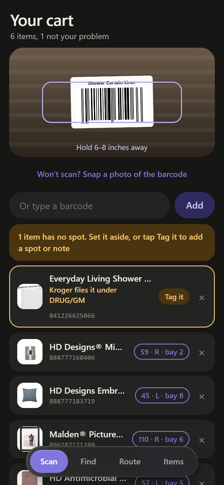
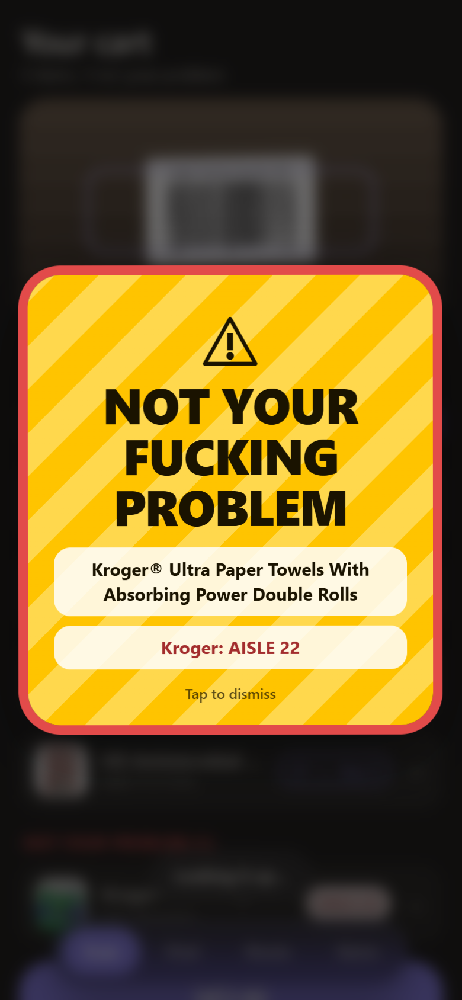
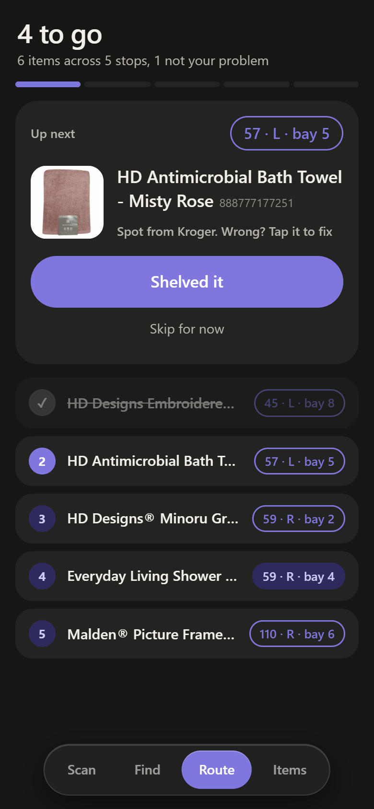
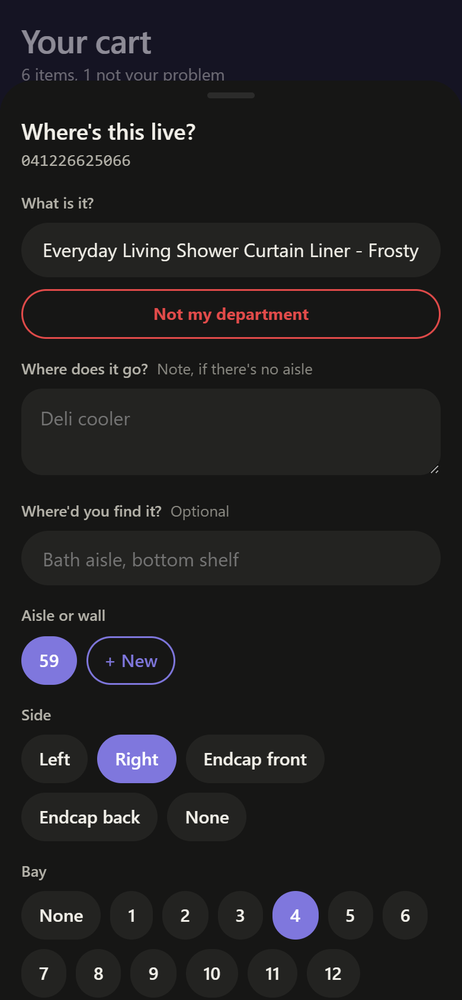
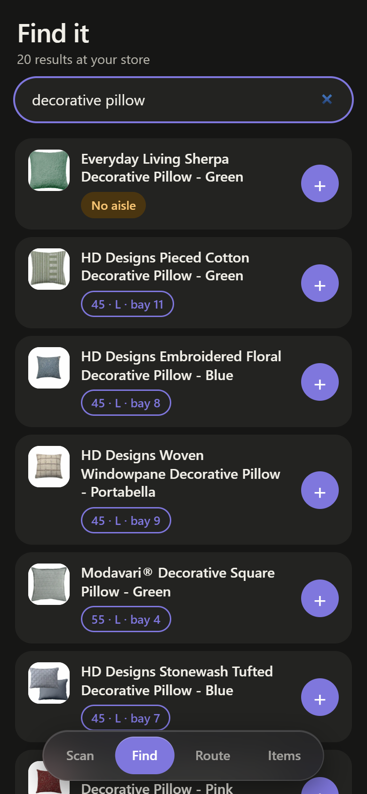
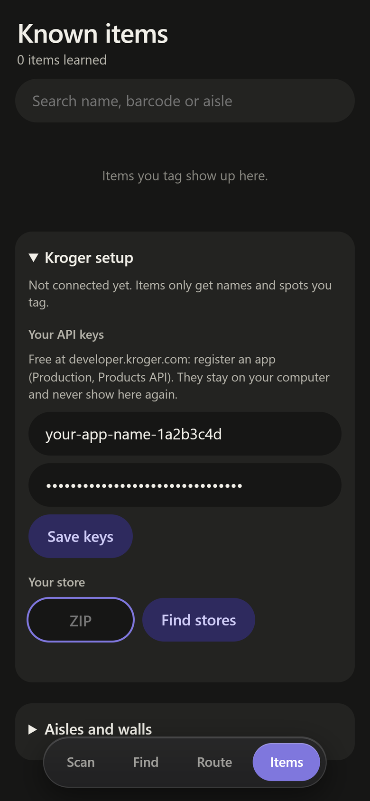

# Putback

A phone app for go-back carts. Scan everything in the cart, and Putback shows where each item lives
at your store (aisle, side and bay), sorts the cart into a walking route, and flags anything you need
to deal with by hand.

> Independent side project. Not affiliated with or endorsed by Kroger or any of its stores.
> Product data comes from Kroger's public developer API using your own keys.

## Screenshots

<table>
  <tr>
    <td align="center"><br><sub>Scan the cart</sub></td>
    <td align="center"><br><sub>Not your department</sub></td>
    <td align="center"><br><sub>Walk the route</sub></td>
  </tr>
  <tr>
    <td align="center"><br><sub>Tag a spot once</sub></td>
    <td align="center"><br><sub>Search by name</sub></td>
    <td align="center"><br><sub>Add your own keys</sub></td>
  </tr>
</table>

## What it does

- **Batch scanning.** Point the camera at each barcode (or snap a photo, or type it). Items stack up
  with their name, photo and spot.
- **Real store spots.** Looks each item up in Kroger's Products API for your store and shows
  aisle · side · bay, plus any second spot ("Also at 45 · L · bay 9").
- **Your department only.** Set your aisle range (say 20 to 60). Anything outside it gets a giant
  full-screen **NOT YOUR FUCKING PROBLEM** sign, goes in a separate pile, and stays off your route.
- **No spot? Tag it once.** Items with no aisle on file get flagged right away. Tag the aisle, side and
  bay, or write a note ("deli cooler"), or mark it *Not my department*. It's remembered from then on.
- **Route.** Sorts the cart into walking order. Tap *Shelved it* as you go.
- **Find.** Search your store by name ("decorative pillow") for items with a missing barcode.
- **Works through bad signal.** Tags save on the phone and sync to your computer when it reconnects.

## How it runs

Putback is a small Node server on your own computer. Your phone opens it in Safari or Chrome.
Phones only allow the camera on `https://` pages, so the easy way to reach it from your phone is
[Tailscale](https://tailscale.com) (free), which also keeps it private to your own devices.

## Setup

1. **Install** (Node 20 or newer):
   ```
   npm install
   ```
2. **Start it:**
   ```
   npm start
   ```
   On Windows, if PowerShell blocks `npm`, run `node server.js` instead.
3. **Share it with your phone** using Tailscale (install it on the computer and the phone, signed in to
   the same account, and turn on MagicDNS and HTTPS certificates in the admin console's DNS page):
   ```
   tailscale serve --bg 3000
   ```
   Open the `https://….ts.net` link it prints on your phone, then **Share › Add to Home Screen**.
4. **Connect Kroger.** Get free keys at [developer.kroger.com](https://developer.kroger.com): create an
   account and register an app (Production environment, Products API). In Putback, open
   **Items › Kroger setup**, paste the Client ID and Client Secret, then enter your ZIP and tap your store.
5. **Set your department.** In **Items › Aisles and walls**, enter your aisle range and any walls or named
   areas you cover.

Without Kroger keys the app still works; items just get the names and spots you tag yourself.

## Your data and keys

Everything personal lives in `data/` on your computer, which is excluded from git:

- `data/kroger.json`: your Kroger keys and store. Keys are checked with Kroger before saving and are
  never sent back to the phone.
- `data/db.json`: your tags and settings. Back it up now and then.

Kroger's terms don't allow building a database from their data, so their answers are only kept in memory
for a few hours. Items Kroger doesn't carry fall back to a free UPC name lookup.

## Tech

Plain Node `http` server (no framework) and a vanilla JS front end. Barcode reading is
[zxing-wasm](https://github.com/Sec-ant/zxing-wasm) (ZXing compiled to WebAssembly), served locally.
